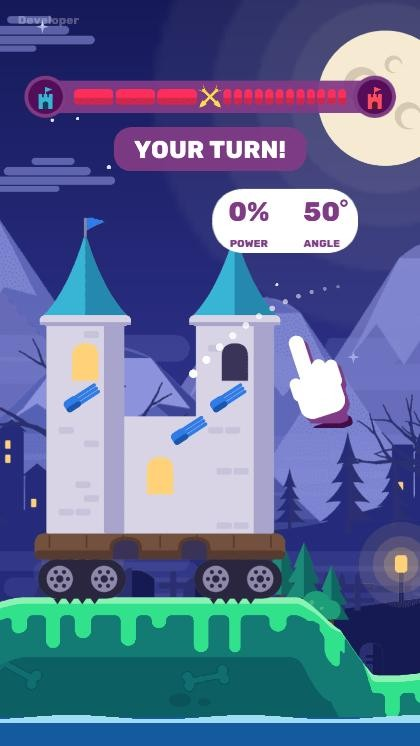
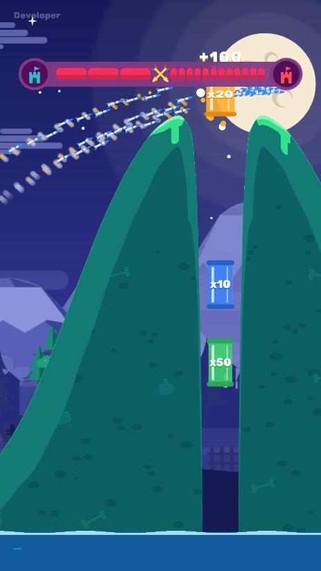
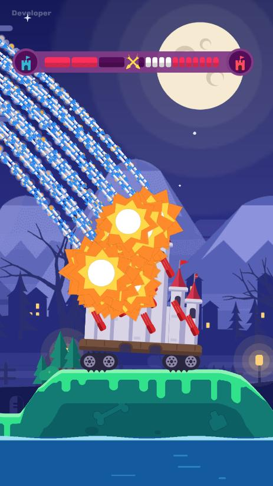
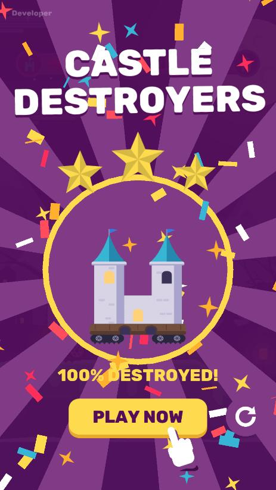

# Castle Destroyers — playable ad

**[▶ Играть в браузере](https://castle-destroyers-playable.skrininshot-trk.workers.dev/)**

Тестовое задание по разработке playable-рекламы, сделанное с помощью [Claude Code](https://claude.com/claude-code). Дуэль замков в духе Worms на Unity 6 с экспортом через Luna (Playworks).

| | | | |
|---|---|---|---|
|  |  |  |  |

## Механики
- **До трёх ходов игрока.** Оттяни палец, выбери силу и угол и отпусти: все пушки замка дают залп. Рука-подсказка показывает выгодный выстрел.
- **Бустеры-умножители.** Ракеты, пролетевшие через `x10`, `x20` или `x50`, размножаются, и из двух десятков получается несколько сотен.
- **Разрушаемость.** Земля и замки разрушаются попиксельно: взрывы прогрызают рельеф, куски откалываются, а пушки падают вместе со стенами.
- **Ответ врага.** Между ходами красный замок стреляет в ответ. Камера следит за полётом через гору к цели.
- **Полное уничтожение.** Начиная со второго хода можно снести все пушки врага. Тогда один мощный взрыв уносит остатки замка с платформой и гусеницами и оставляет большой кратер: вспышка, ударная волна, замедление времени, конфетти.
- **Многократное прохождение.** На финальном экране круглая стрелка начинает матч заново, а тап в любом другом месте ведёт в Google Play.

## Меню разработчика
Едва заметная надпись `Developer` в левом верхнем углу открывает панель: FPS и счётчики систем, замедление времени, стресс-тест на 1000 ракет, смена темы Night / Sunset, ручные взрывы по рельефу, режимы камеры, готовые выстрелы через каждый бустер и рестарт.
